<div align="center">

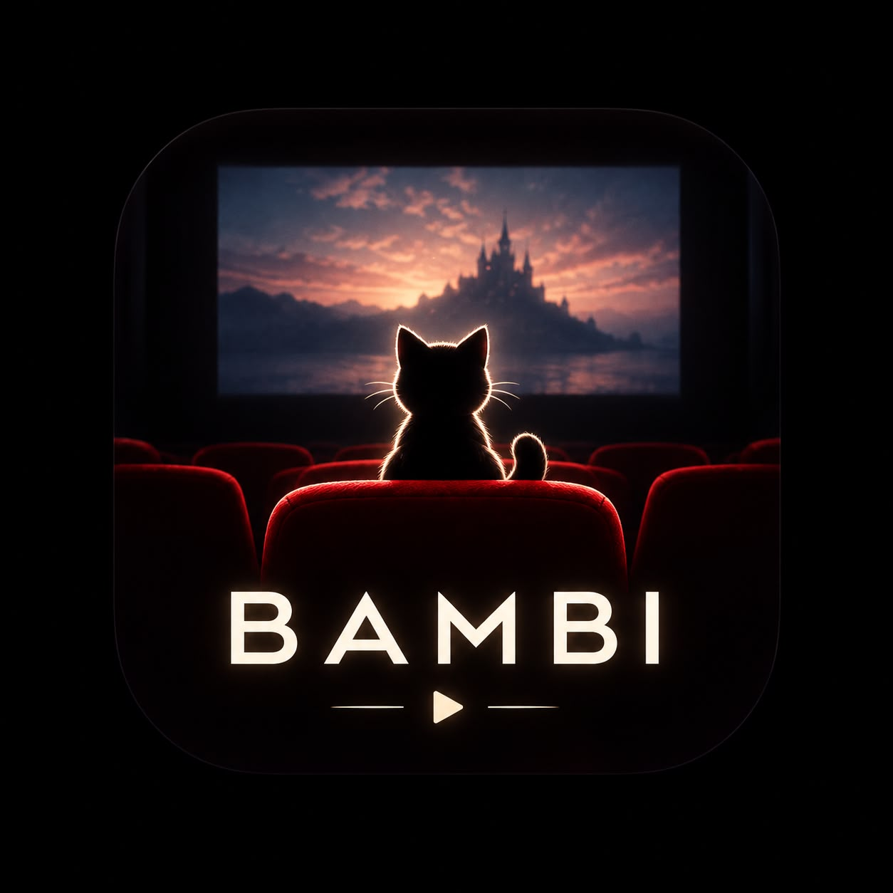

# Bambi

**Tu propio Netflix para Android TV.**
Catálogo de TMDB, fuentes de Torrentio y compañía, reproducción a máxima calidad a través de Real-Debrid
y una interfaz pensada para el mando: perfiles, "Seguir viendo" sincronizado con Trakt, 4K HDR10 y Dolby Vision.


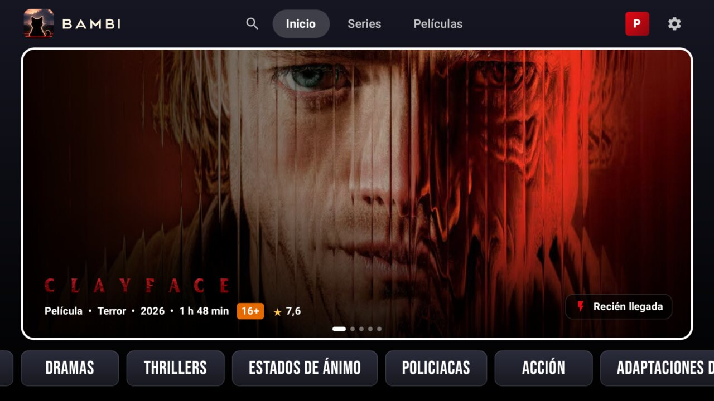

</div>

---

## Índice

- [Qué es Bambi](#qué-es-bambi)
- [Funciones](#funciones)
  - [Perfiles como en Netflix](#perfiles-como-en-netflix)
  - [Sincronización con Trakt](#sincronización-con-trakt)
  - [Inicio y "Seguir viendo"](#inicio-y-seguir-viendo)
  - [Fichas de películas y series](#fichas-de-películas-y-series)
  - [Fuentes](#fuentes)
  - [Reproductor](#reproductor)
  - [Buscar](#buscar)
  - [Ajustes y guía de configuración](#ajustes-y-guía-de-configuración)
- [Instalación](#instalación)
- [Primer arranque: qué necesitas](#primer-arranque-qué-necesitas)
- [Cómo se usa con el mando](#cómo-se-usa-con-el-mando)
- [Compilar desde el código](#compilar-desde-el-código)
- [Cómo está hecho](#cómo-está-hecho)
- [Créditos](#créditos)
- [Licencia](#licencia)
- [Aviso legal](#aviso-legal)

---

## Qué es Bambi

Bambi nació para sustituir a Kodi en una NVIDIA Shield: Kodi iba lento y era incómodo con el mando. Bambi es
una app **nativa** de Android TV (Kotlin + Jetpack Compose para TV + Media3) que:

- muestra el catálogo de **TMDB** con portadas, sinopsis, temporadas, edades y logos en tu idioma;
- busca **fuentes** en varios sitios a la vez (Torrentio, The Pirate Bay, Knaben, Nyaa, Comet, AIOStreams…);
- las reproduce al instante a través de **Real-Debrid** (u otros servicios debrid), en **4K, HDR10 y Dolby Vision**;
- recuerda por dónde vas en cada perfil y lo **sincroniza con Trakt** entre todas tus teles.

Todo pensado para el mando: el foco siempre sabe dónde está, nada de ratones ni menús escondidos.

---

## Funciones

### Perfiles como en Netflix

<table>
<tr>
<td width="50%">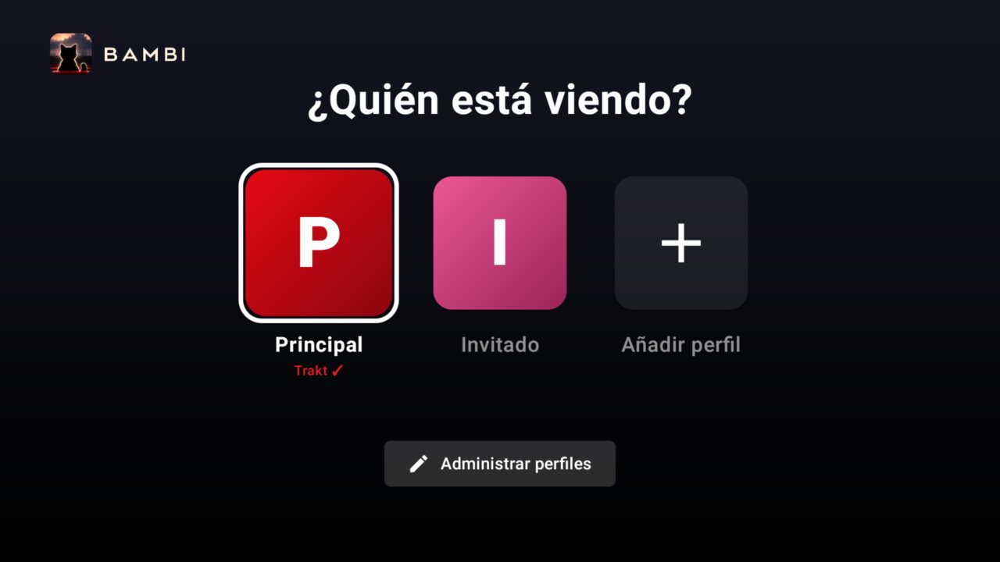</td>
<td width="50%">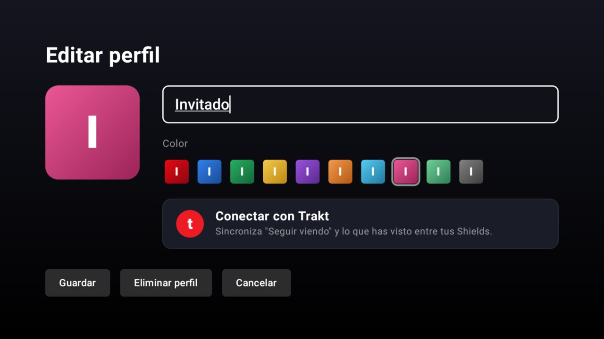</td>
</tr>
</table>

- **"¿Quién está viendo?"** cada vez que abres la app.
- Hasta **5 perfiles**, cada uno con su nombre, su color y su propio **"Seguir viendo"**, sus vistos y su progreso.
- **Administrar perfiles**: añadir, renombrar, cambiar el color o eliminar (con confirmación).
- El avatar del perfil activo está siempre arriba a la derecha: un OK y cambias de perfil.
- **PIN de 4 cifras** por perfil: se pide para entrar en él y para editarlo.
- **Perfil infantil**: Inicio, portada, categorías y búsqueda solo con contenido para niños.
- Al actualizar desde una versión sin perfiles, todo tu progreso pasa a un perfil "Principal": no se pierde nada.

<p align="center">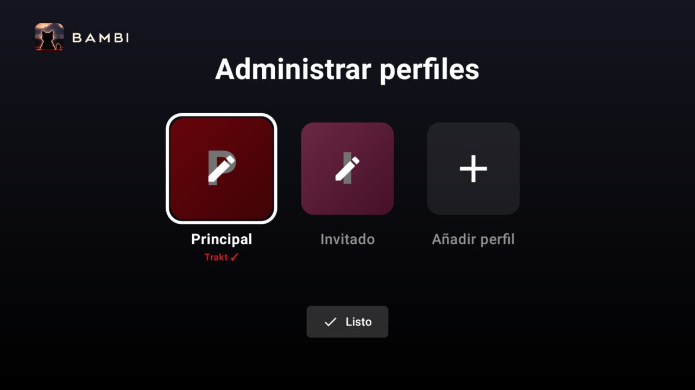</p>

### Sincronización con Trakt

<p align="center">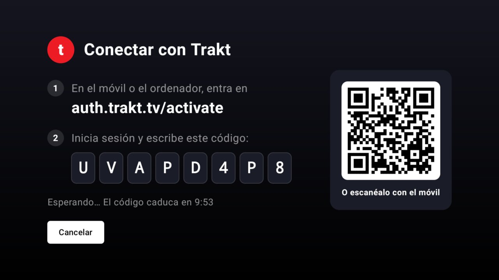</p>

Cada perfil puede enlazar **su propia cuenta de [Trakt](https://trakt.tv)**, como se enlaza Netflix en una tele:
aparece un código (y un QR), lo escribes en el móvil y listo.

- **Lo que ves se apunta solo** (*scrobble*): empezar, pausar y salir. Pasado el 80 %, Trakt lo marca como visto.
- **"Seguir viendo" igual en todas tus teles**: deja una película a medias en el salón y retómala en el dormitorio
  en el mismo minuto.
- **Vistos sincronizados**: los ticks de los episodios salen también de tu historial de Trakt.
- Al enlazar, lo que ya habías visto en esa tele **se sube** a Trakt.
- **Quitar de "Seguir viendo"** también lo quita de Trakt, para que no reaparezca en la otra tele.
- **"Mi lista"** es tu *watchlist* de Trakt: lo que añadas en una tele sale en la otra.
- Si Trakt no responde, la app sigue funcionando con su progreso local.

### Inicio y "Seguir viendo"

<table>
<tr>
<td width="50%"></td>
<td width="50%">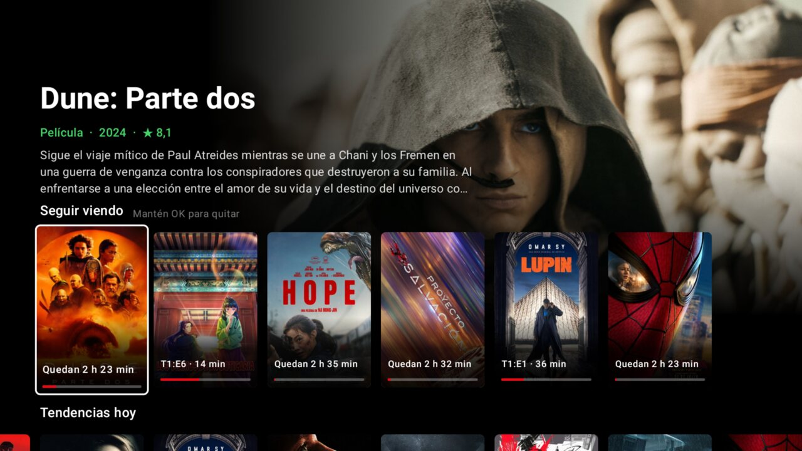</td>
</tr>
</table>

- **Portada** estilo Netflix con logos de los títulos, edad recomendada, nota y etiquetas ("Recién llegada",
  "La película del momento"…).
- Pestañas **Inicio · Series · Películas · Mi lista** y **categorías** (Dramas, Thrillers, Estados de ánimo,
  Policiacas…). En Ajustes eliges qué categorías se ven.
- **Mi lista**: guarda películas y series desde su ficha; tiene su propia pestaña (con filtro Todo / Series /
  Películas) y una fila en el Inicio.
- Filas de **Tendencias**, **Top 10 de hoy** y muchas más.
- **Seguir viendo** con barra de progreso y lo que te queda ("T1:E6 · 14 min"). Mantén OK para quitar un título.
- Desplazamiento suave y precompilado: la app se instala con un perfil de arranque para que vaya fluida desde el
  primer día.

### Fichas de películas y series

<table>
<tr>
<td width="50%">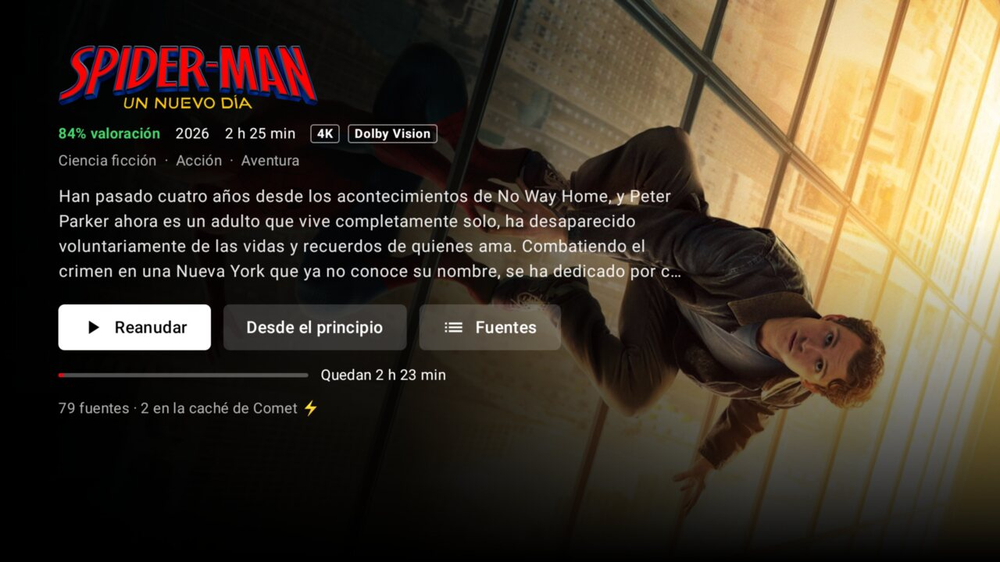</td>
<td width="50%">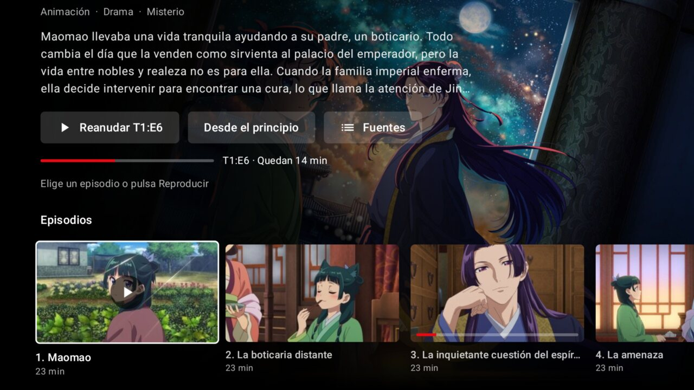</td>
</tr>
</table>

- Logo, valoración, duración y las **etiquetas de calidad** reales de lo que hay disponible (4K, Dolby Vision, HDR10).
- **Reanudar** donde lo dejaste o **Desde el principio**.
- Series con **temporadas y episodios**, ticks de vistos y barra de progreso en cada episodio.
- **Marcar como visto** una película o una temporada entera, o un episodio manteniendo OK sobre él.
- Botón **Mi lista** para guardarla.
- Al volver de una ficha, el foco sigue en el título donde estabas.

### Fuentes

<table>
<tr>
<td width="50%">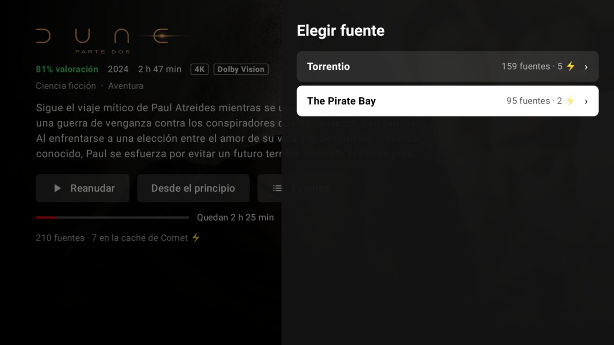</td>
<td width="50%">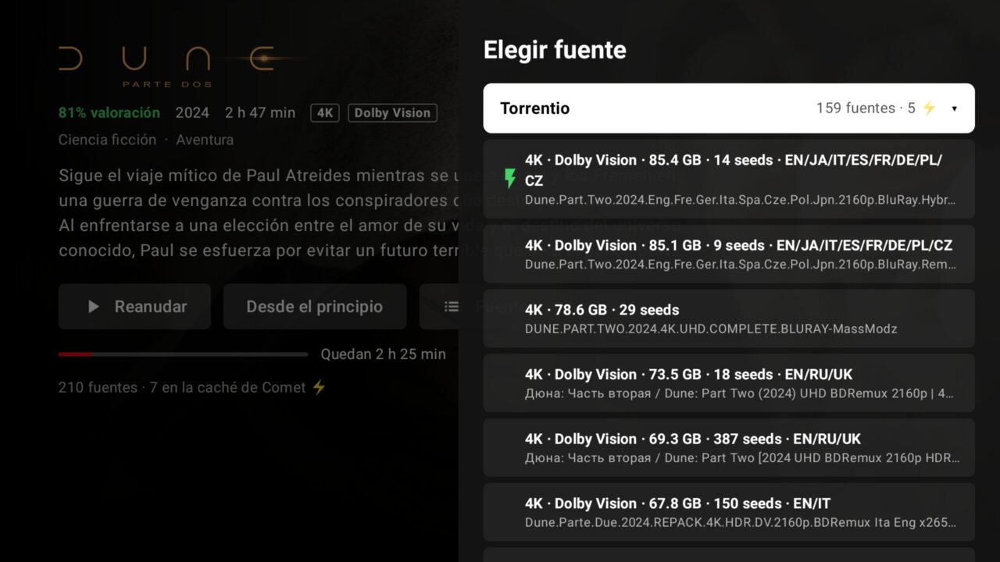</td>
</tr>
</table>

- Varios buscadores **a la vez**, cada uno en su sección:
  - **Torrentio**, el de siempre en Stremio;
  - **Peerflix**, con mucho contenido en castellano (DonTorrent, MejorTorrent, Wolfmax4k…);
  - **The Pirate Bay**, que agrupa los buscadores propios de Bambi: The Pirate Bay, Knaben (1337x, Nyaa…), Nyaa (anime) y Comet;
  - **AIOStreams** o cualquier otro addon de Stremio, pegando la URL de su manifiesto.
- **Resultados progresivos**: cada sección aparece en cuanto responde su buscador ("Buscando…" en las demás).
- Ordenadas por **calidad y tamaño**, con idioma, *seeds* y el nombre de la release.
- **Castellano primero** (Ajustes) sube arriba las fuentes con audio en español, y el botón **Solo en español**
  del panel esconde las demás.
- **Anime**: además de "S01E05" busca por numeración absoluta ("One Piece - 894"), como se llaman sus releases.
- **⚡ = en caché**: se reproduce al instante. Lo que un buscador sabe que está en caché se marca también en los demás.
- **"Reproducir" elige solo**: prueba las fuentes en orden hasta que una funciona. Se salta las que Real-Debrid
  bloquea o que no son vídeo, y frena si Real-Debrid pide calma.
- **Packs de temporada**: si la fuente es la temporada completa, reproduce el episodio correcto de dentro del pack.
- Resistente a los bloqueos de algunas operadoras (p. ej. las IP de Cloudflare durante el fútbol): si una IP no
  responde, prueba otra.

**Servicios debrid**: **Real-Debrid** (conexión directa desde la tele) y, a través de Torrentio, **TorBox**,
**Premiumize**, **AllDebrid**, **Debrid-Link** y **Offcloud**.

### Reproductor

<table>
<tr>
<td width="50%">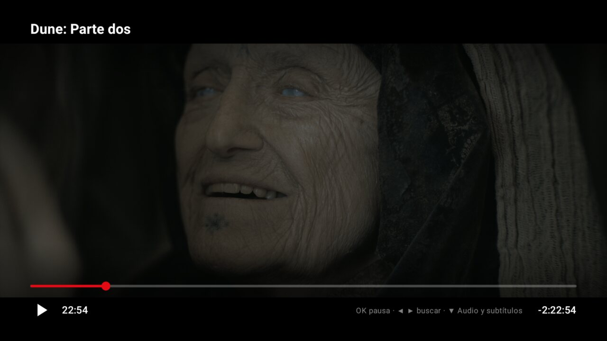</td>
<td width="50%">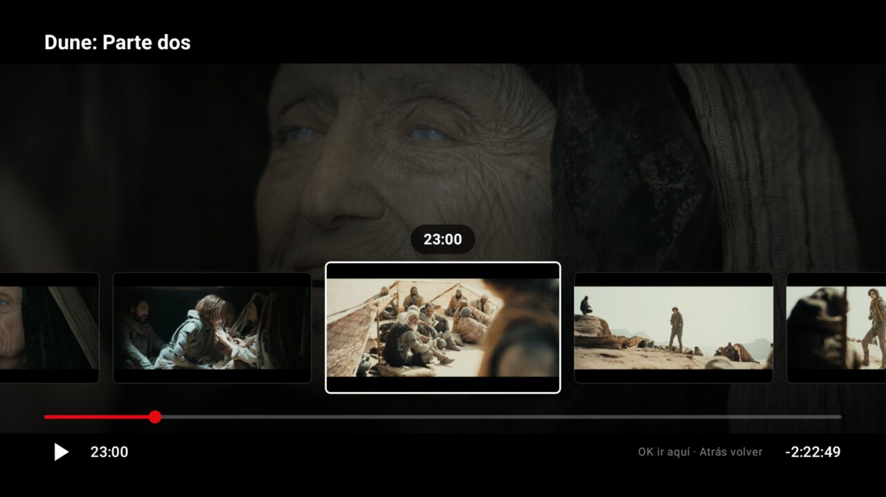</td>
</tr>
</table>

- **Media3 (ExoPlayer)** afinado para la Shield: **4K HDR10, Dolby Vision** (incluido el perfil 7 de los remux de
  Blu-ray) y **AV1** por software (dav1d).
- **Búsqueda con miniaturas**: ◀ ▶ pausan y muestran fotogramas del punto elegido; OK salta ahí.
- Panel de **audio y subtítulos** con todas las pistas del archivo.
- **Subtítulos externos** de OpenSubtitles, Podnapisi y SubDL, con **sincronización automática** usando como
  referencia los subtítulos del propio archivo.
- **Reanuda** donde lo dejaste, guarda el progreso solo y, si pulsas Home, libera el decodificador y el modo
  HDR/DV de la tele y vuelve al mismo punto.
- **Omitir intro / resumen** y tarjeta de **siguiente episodio** en los créditos (datos de IntroDB), con paso
  automático al siguiente que se puede desactivar en Ajustes.
- Con "Castellano primero", si una fuente decía ser en español y su audio no lo es, prueba otra.
- Si una fuente falla al abrir, pasa sola a la siguiente; si falla a mitad, reintenta en el mismo punto. Si un
  addon devuelve un vídeo con su mensaje de error en lugar del episodio, también pasa a la siguiente.
- MKV con pistas que Media3 no sabe leer (p. ej. subtítulos comprimidos con zlib): se ignora solo esa pista y se
  reproduce el resto.

<p align="center">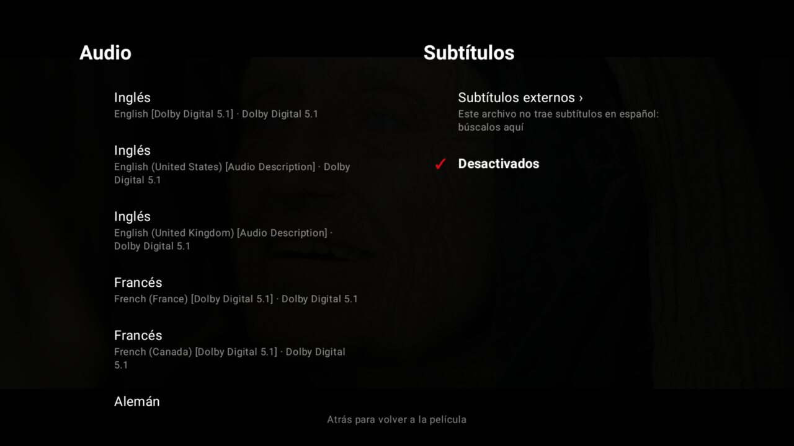</p>

### Buscar

<p align="center">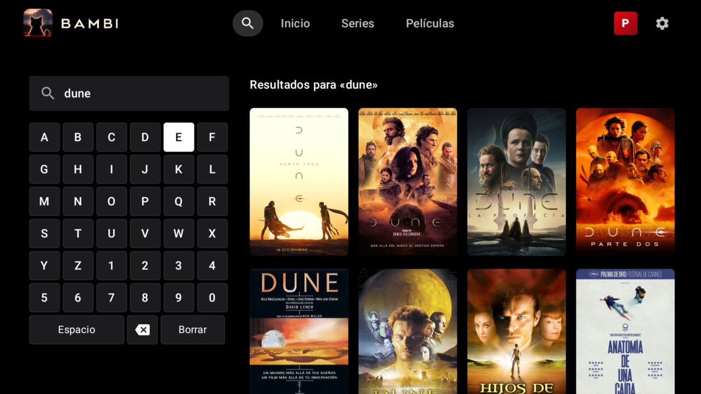</p>

Teclado en pantalla pensado para el mando (ABC o QWERTY, con Ñ) o el teclado del sistema, resultados al momento
y, sin escribir nada, **lo más visto hoy**.

### Ajustes y guía de configuración

<table>
<tr>
<td width="50%">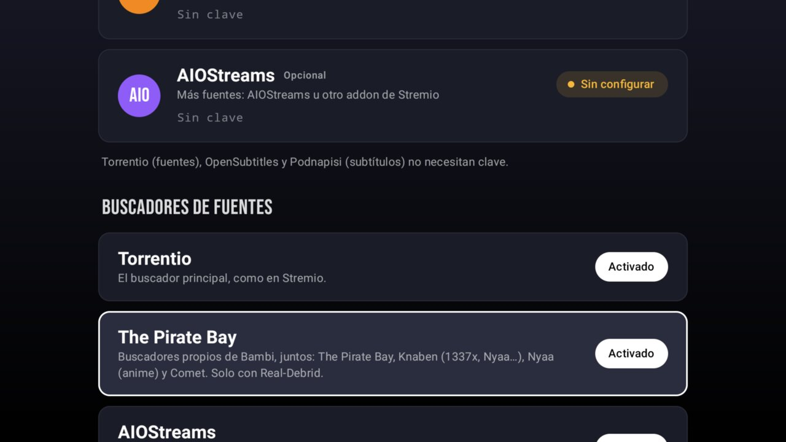</td>
<td width="50%">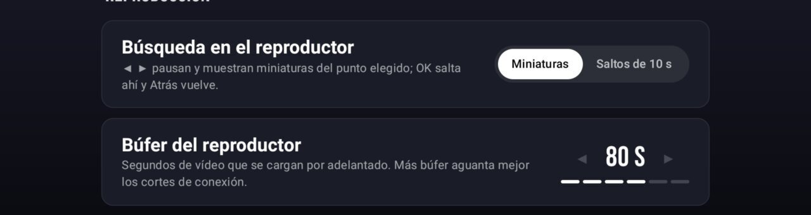</td>
</tr>
</table>

- **Guía de configuración** en el primer arranque: cada paso explica cómo sacar la clave y enseña un **QR** que
  abre esa página en el móvil.
- Claves guardadas **cifradas** en la tele (AES-256 con el Keystore de Android) y comprobadas al guardarlas.
  Real-Debrid muestra tu usuario y los días de Premium que te quedan.
- Activar o desactivar cada **buscador de fuentes**.
- **Búsqueda** con miniaturas o saltos de 10 s, y **búfer** del reproductor ajustable.
- **Idioma de la app: español o inglés**. Cambia menús, títulos, sinopsis y el audio preferido.

---

## Instalación

1. Descarga **`Bambi.apk`** de la última versión en [**Releases**](../../releases). Este enlace apunta siempre a
   la última: `https://github.com/grodri99/bambi/releases/latest/download/Bambi.apk`
2. Instálalo en la Shield, o en cualquier Android TV con Android 5.0 o superior:
   - con **adb**: `adb connect IP_DE_LA_TELE` y luego `adb install Bambi.apk`;
   - o con una app tipo *Downloader* / *Send Files to TV*.
3. Ábrelo: la **guía de configuración** te lleva paso a paso.

### Actualizaciones

Desde la **1.0.6**, Bambi mira en GitHub si hay una versión nueva (al abrirla, como mucho cada 6 h, o a mano en
Ajustes → "Buscar actualizaciones"). Si la hay, avisa con las novedades y se descarga e instala desde el propio
aviso, sin perder perfiles ni progreso. La primera vez Android pide permitir "Instalar apps desconocidas" para
Bambi: el aviso lleva a esa pantalla.

> Recomendado: una **NVIDIA Shield TV** (2019 o Pro). Es donde se ha probado todo, incluido Dolby Vision.

---

## Primer arranque: qué necesitas

| Servicio | ¿Obligatorio? | Para qué | Dónde se saca |
|---|---|---|---|
| **TMDB** | Sí | Catálogo, portadas, sinopsis, temporadas, edades | [themoviedb.org/settings/api](https://www.themoviedb.org/settings/api) (gratis) |
| **Real-Debrid** (u otro debrid) | Sí | Reproducir las fuentes a máxima velocidad | [real-debrid.com/apitoken](https://real-debrid.com/apitoken) |
| **SubDL** | No | Más subtítulos externos | [subdl.com/panel/api](https://subdl.com/panel/api) (gratis) |
| **AIOStreams** | No | Más fuentes (o cualquier addon de Stremio) | URL del manifiesto de tu configuración |
| **Trakt** | No | Sincronizar "Seguir viendo" y vistos entre teles | Se enlaza en cada perfil con un código |

Torrentio, OpenSubtitles y Podnapisi no necesitan clave.

---

## Cómo se usa con el mando

| Dónde | Botón | Qué hace |
|---|---|---|
| Inicio | **Atrás** | Sube al menú superior |
| Seguir viendo | **Mantener OK** | Quitar el título de la fila |
| Ficha | **OK** en un episodio | Lo reproduce (elige la mejor fuente solo) |
| Ficha | **Fuentes** | Elegir tú la fuente |
| Reproductor | **OK** | Pausa / sigue |
| Reproductor | **◀ ▶** | Búsqueda con miniaturas (OK salta, Atrás vuelve) |
| Reproductor | **▼** | Audio y subtítulos |
| Ajustes | **◀ ▶** | Cambiar una opción (idioma, búfer, debrid…) |

---

## Compilar desde el código

Necesitas **JDK 17** y el **Android SDK** (API 35). El decodificador AV1 de Media3 ya va precompilado en
`app/libs/`, igual que las librerías nativas de dav1d.

1. Crea `local.properties` en la raíz del proyecto, con la ruta del SDK y, si quieres, tus claves como valores
   iniciales (se guardan cifradas en la primera ejecución y desde ahí mandan los Ajustes):

   ```properties
   sdk.dir=/ruta/al/android-sdk

   # Opcionales: valores iniciales de las claves (si no, se ponen en la guía de configuración)
   tmdbApiKey=...
   rdToken=...
   subdlApiKey=...

   # Trakt: crea una app en https://developer.trakt.tv/apps (tipo "Production").
   # Desde oct-2026 Trakt solo da Client ID; el secreto es opcional.
   traktClientId=...
   traktRedirectUri=https://...       # la misma que pusiste al crear la app

   # seedKeys=false → APK sin tus claves (para dárselo a otra persona)
   # seedKeys=false

   # Firma de la release (si no, usa la clave de depuración)
   releaseStoreFile=keystore/bambi.keystore
   releaseStorePassword=...
   releaseKeyAlias=...
   releaseKeyPassword=...
   ```

2. Compila:

   ```bash
   ./gradlew assembleDebug     # "Bambi (pruebas)": se instala al lado de la normal, con sus propios datos
   ./gradlew assembleRelease   # "Bambi"
   ```

3. Instala y, para que vaya fluida desde el primer momento, precompila con el perfil de arranque:

   ```bash
   adb install -r app/build/outputs/apk/release/app-release.apk
   adb shell am broadcast -a androidx.profileinstaller.action.INSTALL_PROFILE \
       com.shieldstream.tv/androidx.profileinstaller.ProfileInstallReceiver
   adb shell cmd package compile -m speed-profile -f com.shieldstream.tv
   ```

---

## Cómo está hecho

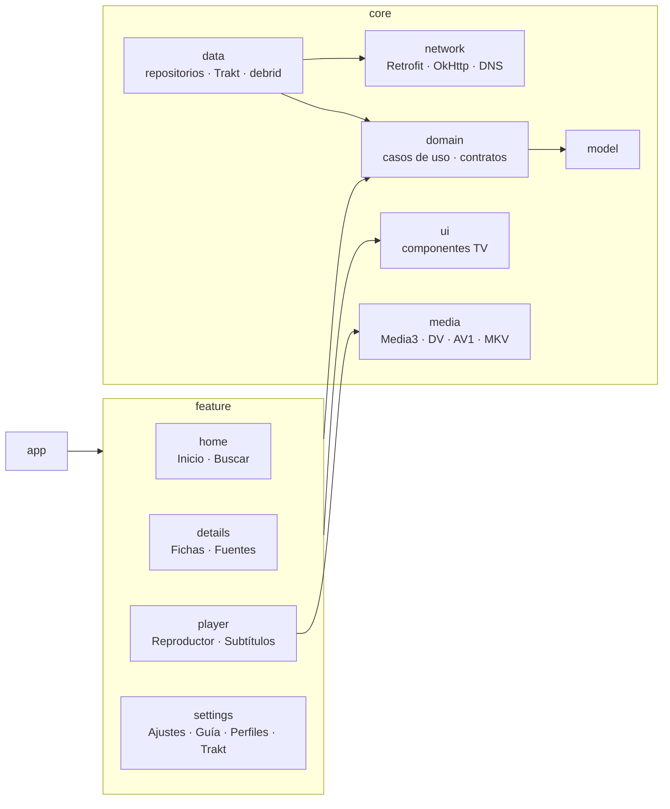

- **Arquitectura**: multi-módulo, *clean* (domain sin Android), **Hilt** para la inyección, estado de cada pantalla
  con `StateFlow` + `sealed interface UiState`.
- **UI**: Jetpack Compose + Compose for TV, foco gestionado a mano para que el mando nunca se pierda.
- **Red**: Retrofit + OkHttp + kotlinx.serialization; DNS propio que esquiva IPs bloqueadas.
- **Reproducción**: Media3 1.6 con renderer propio para Dolby Vision perfil 7, AV1 (libgav1 / dav1d) y un lector de
  MKV tolerante.
- **Datos**: claves cifradas con `EncryptedSharedPreferences`; progreso por perfil; Trakt con *device auth*.

---

## Créditos

- Catálogo e imágenes: **[TMDB](https://www.themoviedb.org)**. *This product uses the TMDB API but is not
  endorsed or certified by TMDB.*
- Sincronización: **[Trakt](https://trakt.tv)**.
- Fuentes: **Torrentio**, **Peerflix**, **Comet**, **AIOStreams** y los buscadores públicos citados.
- Saltar intro y créditos: **[IntroDB](https://introdb.app)** (base de datos colaborativa).
- Ideas y lógica de varias funciones (saltar intro, siguiente episodio…) inspiradas en
  **[NuvioTV](https://github.com/NuvioMedia/NuvioTV)** (GPL-3.0).
- Subtítulos: **OpenSubtitles**, **Podnapisi**, **SubDL**.
- Reproducción: **[AndroidX Media3](https://github.com/androidx/media)** y **[dav1d](https://code.videolan.org/videolan/dav1d)**.
  El lector de MKV tolerante es una copia modificada de `MatroskaExtractor` de Media3 (Apache 2.0).

---

## Licencia

Bambi es **software libre**: puedes usarlo, estudiarlo, modificarlo y compartirlo bajo los términos de la
**GNU General Public License v3.0** ([LICENSE](LICENSE)). Si distribuyes una versión modificada, tiene que seguir
siendo GPL-3.0 y con su código disponible. Las partes de terceros conservan su licencia (el lector de MKV basado en
Media3 es Apache 2.0, compatible con la GPL-3.0).

---

## Aviso legal

Bambi **no aloja, no sube y no distribuye contenido**. Es un cliente que consulta servicios de terceros que
configura cada usuario con sus propias cuentas y claves. Eres responsable de cumplir las leyes de tu país y las
condiciones de los servicios que uses. Bambi no tiene relación con TMDB, Trakt, Real-Debrid ni ninguno de los
servicios mencionados, y el nombre "Bambi" no tiene relación con ninguna marca registrada.
